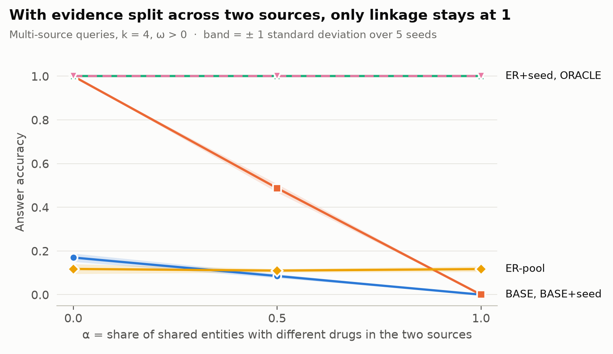
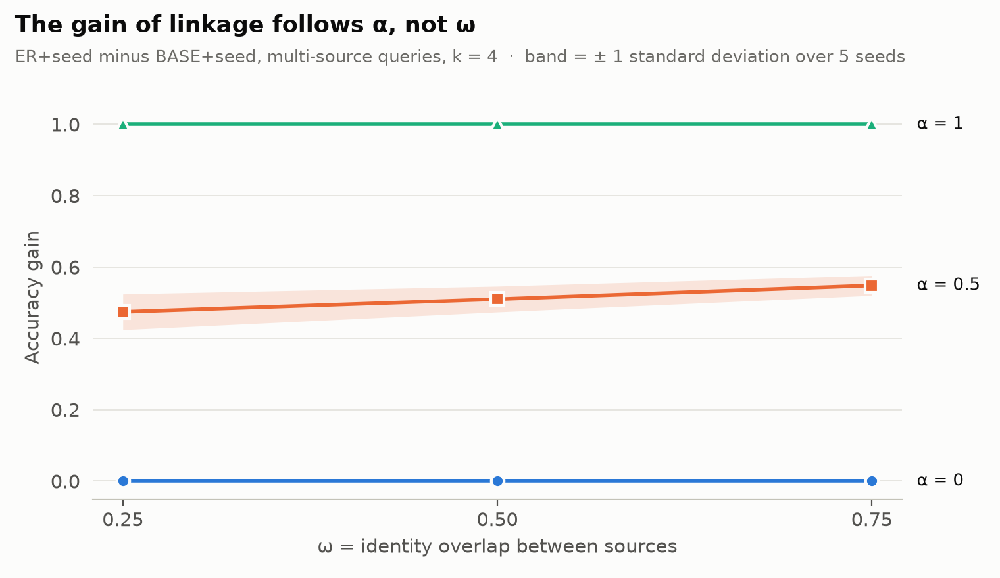
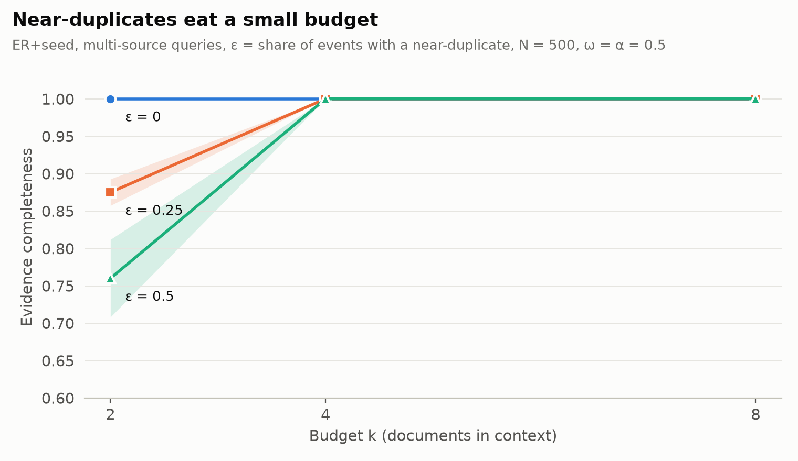
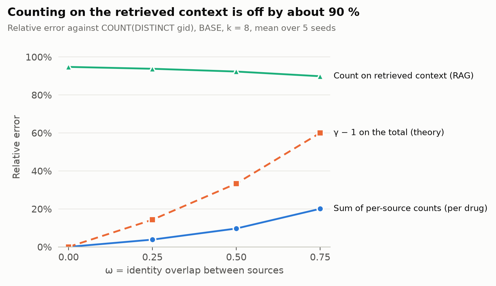
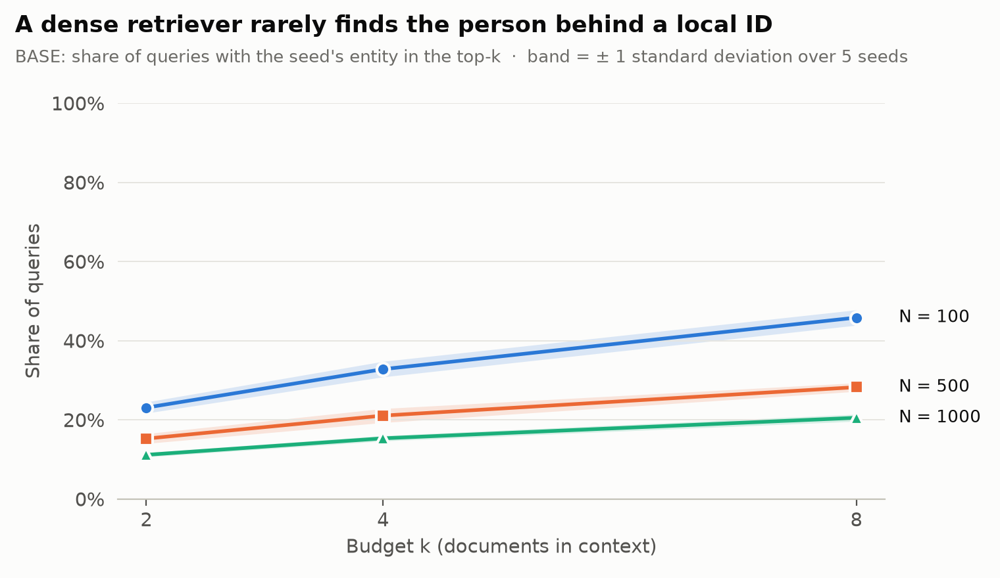
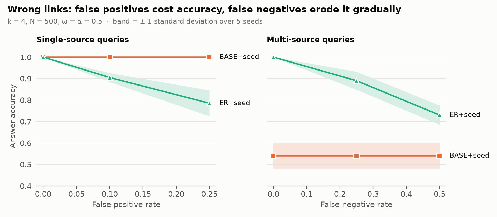

<p align="center">
  <picture>
    <source media="(prefers-color-scheme: dark)" srcset="assets/hero-dark.svg">
    
  </picture>
</p>

<h1 align="center">RAGER</h1>

<p align="center"><b>Same patient, two IDs, half an answer.</b><br>
A benchmark that measures when Entity Resolution makes RAG over federated sources answer correctly,
at the same context budget.</p>

<p align="center">
  
  
  
  
  <a href="LICENSE"></a>
</p>

A hospital knows a patient as `H:3`. A pharmacy knows the same patient as `P:1`. Ask a RAG system which drugs
`H:3` received, and it reads the hospital record, answers "Insulin" and never sees the Aspirin on the
pharmacy side. RAGER gives the retriever a global ID (GID) from Entity Resolution, then measures what that
link is worth on 180 synthetic datasets with known ground truth.

## Results at a glance

Answer accuracy, k = 4 documents, mean over 5 seeds ([all tables](results/tables.md)):

| Query | BASE | BASE+seed | **ER+seed** | ER-pool | ORACLE |
|---|---|---|---|---|---|
| Evidence split across sources | 0.09 | 0.50 | **1.00** | 0.11 | 1.00 |
| Evidence in one source | 0.03 | 1.00 | **1.00** | 0.21 | 1.00 |

- **Linkage pays exactly where evidence is split.** Over the same seed without linkage, ER adds 0, 0.5 and
  1.0 accuracy as complementarity α goes 0, 0.5, 1. Source overlap ω barely moves it.
- **Blind expansion wastes the budget.** Pulling in every entity found by search (ER-pool) fills the k slots
  with the wrong people: 0.11 against 1.00 for targeted expansion.
- **Never let RAG count.** Counting distinct patients on the retrieved context misses by 76–99 %.
  `COUNT(DISTINCT gid)` on metadata is exact.
- **Dense search does not read IDs.** BASE puts the asked-about person in its top-k for 11–46 % of queries.
- **An LLM agrees.** Two local Qwen models reproduce the deterministic reader's verdicts in 97 % of cases.



## Quick start

Python 3.12, CPU only. The embedding model (about 470 MB) downloads on first run.

```powershell
python -m venv .venv
.venv\Scripts\python -m pip install -r requirements.txt
.venv\Scripts\python src\minimal_benchmark.py      # seconds: the hospital/pharmacy example
.venv\Scripts\python src\experiment.py --rapido     # under a minute: reduced grid
```

On Linux or macOS use `.venv/bin/python`. Every command runs from the repository root.

| Command | Output | Time |
|---|---|---|
| `python src/dataset.py` | `data/documents.*` | seconds |
| `python src/questions.py` | `data/questions.json` | seconds |
| `python src/minimal_benchmark.py` | `results/minimal_benchmark.csv` | seconds |
| `python src/experiment.py` | `results/experiment_*.csv` (full grid) | about 20 min |
| `python src/extensions.py` | `results/extension_*.csv` | minutes |
| `python src/export_datasets.py` | `data/parametric/` | about a minute |
| `python src/analysis.py` | `results/tables.md` | seconds |
| `python src/plots.py` | `results/plots/` (Italian) and `results/plots/en/` | seconds |

Every script checks itself with `assert` and stops on failure: the generator against the paper's formulas,
the GID never in the text, ER+seed equal to BASE+seed when all evidence sits in one source.

## How it works

```
synthetic sources → documents (local_id, source, GID in metadata) → embeddings → one federated vector index
→ semantic search → [GID expansion + rerank] → context (k documents) → reader → evaluation
```

- **Embeddings**: `sentence-transformers/paraphrase-multilingual-MiniLM-L12-v2`, 384 dimensions, normalized.
- **Vector index**: one in-memory ChromaDB collection for all sources. HNSW runs single-threaded with
  `ef_search = 2000`, so top-k is deterministic and equal to exact search.
- **The GID lives in metadata only.** In the text, the embedding would do the linkage for free.
- **ER is a parameter, not an algorithm.** The GID is known by construction. The minimal example has four
  alternative partitions; imperfect ER is simulated with false-negative and false-positive links.

### Systems

All of them return at most k documents.

| System | Document selection |
|---|---|
| `BASE` | semantic top-k |
| `BASE+seed` | documents of the local ID named in the query, reranked; the fair baseline |
| `ER+seed` | documents of the seed's GID, reranked |
| `ER-pool` | BASE top-k, then every document of the GIDs found, entity by entity |
| `ORACLE` | ground-truth evidence, reranked (upper bound) |

### Readers

- **Deterministic reader** (main measure): collects the attributes of the documents that belong to the
  queried entity, by local ID without ER and by GID with ER. It isolates retrieval from generation.
- **LLM reader** (optional): same prompt, model, temperature 0, seed 0 and 400-token limit for every system.
  With ER, each document in the context carries its entity label.

### Metrics

| Metric | Definition |
|---|---|
| Recall@k | relevant documents retrieved / relevant documents |
| Precision@k | relevant documents retrieved / documents retrieved |
| Completeness | 1 if every required piece of evidence is covered |
| Accuracy | 1 if the reader's answer equals the ground truth exactly |
| Cost | documents and tokens in the context |
| Disambiguation | BASE's top-k contains the seed's entity |

Means are taken over the queries of a seed, then reported as mean ± standard deviation over 5 seeds.

## Experiments

| Study | Setup |
|---|---|
| Minimal example | 8 clinical events, 2 sources, 4 ER partitions; entity-centric, multi-hop, counting and negative queries |
| Parametric grid | N ∈ {100, 500, 1000} × ω ∈ {0, .25, .5, .75} × α ∈ {0, .5, 1} × 5 seeds = 180 datasets; k ∈ {2, 4, 8}; 40 single-source, 40 multi-source and 6 counting queries per dataset |
| Robustness (N = 500, ω = α = 0.5) | dirty ER (several local IDs per person), false matches, near-duplicates, wrong IDs in text |
| LLM generation | minimal example plus a sample of the grid, two local models |

Generator: two sources with N local identities each, S = round(ωN) shared entities, V = 2N − S global
entities and overcount factor γ = 2N / (2N − S). Each entity has two events; for a share α of the shared
entities the two sources report different drugs, so a complete answer needs both.

| Hypothesis | Evidence |
|---|---|
| H1. ER improves recall of evidence spread over sources for the same entity | T1, T2, G1 |
| H2. The benefit grows with complementarity and with queries that need several sources | T3, T4, G1, G2 |
| H3. Indiscriminate GID expansion wastes the budget | T6, robustness, G3 |
| H4. The improvement does not depend on overlap ω alone | T4, T5, G2 |

<table>
  <tr>
    <td></td>
    <td></td>
  </tr>
  <tr>
    <td></td>
    <td></td>
  </tr>
</table>



## Optional: LLM generation

Any OpenAI-compatible endpoint works (`/v1/chat/completions`), for example a local llama.cpp server.

| Variable | Meaning |
|---|---|
| `LLM_URL` | endpoint, default `http://127.0.0.1:8080/v1` |
| `LLM_MODEL` | model id as listed by `GET /v1/models` |
| `LLM_KEY_FILE` | optional file holding the API key; the key never goes in code |
| `LLM_TAG` | suffix of the output files |

```powershell
$env:LLM_MODEL = "<model id>"; $env:LLM_TAG = "mymodel"
python src/llm.py tutto        # or: minimo | parametrico
```

Responses are cached in `results/llm_cache.jsonl`, keyed by model, parameters and prompt. With the committed
cache, a rerun reproduces the published LLM results without calling a model.

## Repository layout

```
src/
  rag.py                 core: encoder, index, systems, readers, metrics
  dataset.py             minimal example documents
  questions.py           minimal example questions and ground truth
  minimal_benchmark.py   benchmark on the minimal example
  generator.py           parametric generator (N, ω, α, dirty records)
  experiment.py          parametric grid
  extensions.py          robustness studies
  export_datasets.py     exports the 180 generated datasets
  analysis.py            summary tables
  plots.py               figures with variability bands
  llm.py                 optional LLM generation
data/
  documents.{json,csv}   minimal example
  questions.json         minimal example questions
  parametric/            180 datasets: documents.csv, questions.json
results/
  *.csv                  per-query and aggregated metrics
  tables.md              summary tables T1–T8 and robustness tables
  plots/                 figures G1–G6 (Italian), plots/en/ (English)
  llm_cache.jsonl        cached LLM responses
assets/                  README banner and its generator
```

| Field | Meaning |
|---|---|
| `document_id` / `doc_id` | one document = one event |
| `source` | data owner (`H` hospital, `P` pharmacy) |
| `local_id` | person ID inside its source |
| `gid` | global entity ID (metadata only) |
| `farmaco`, `quantita` | drug and quantity of the event |
| `tipologia` / `tipo` | query type: single-source, multi-source, counting |

Column names and code comments are in Italian.

## Reproducibility

- Seeds: datasets use `s ∈ {0,…,4}`, question sampling `1000 + s`, robustness perturbations `2000 + s`.
- Library versions are pinned in [`requirements.txt`](requirements.txt).
- Deterministic HNSW search; LLM at temperature 0, seed 0.
- Every comparison uses the same queries, the same budget k and the same model.

## Scope

RAGER isolates one question: what a correct link between local IDs is worth to retrieval. It uses simple
text templates, one embedding model and two sources, and starts from ideal ER; false positives are drawn
between non-shared entities, and homonyms appear only as equal local numbers in different sources. A shared
stable GID is not privacy-preserving record linkage and can reveal that a person appears in several sources,
which is why every record here is synthetic.

## License

[MIT](LICENSE). Developed as a Business Intelligence course project.
