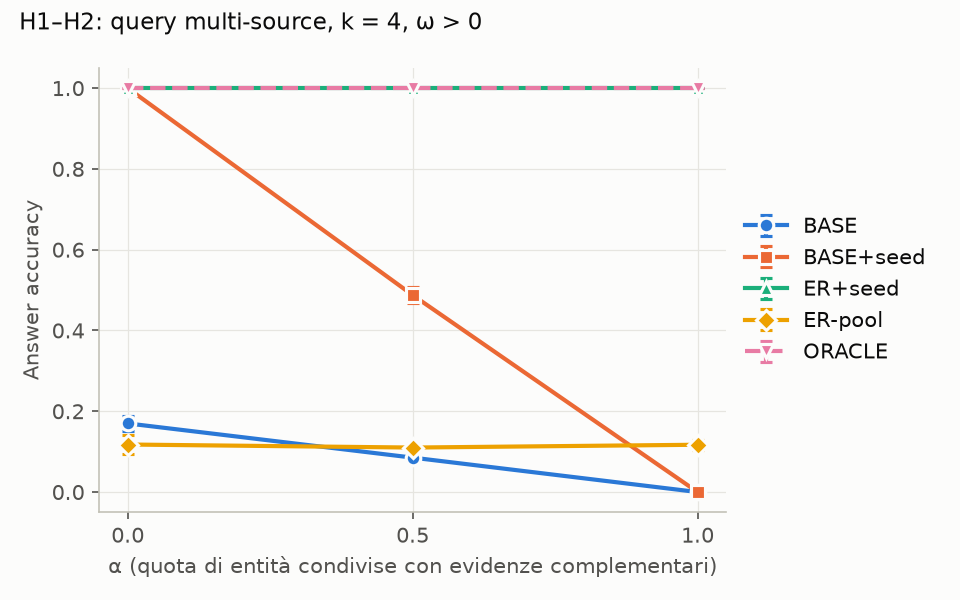

# RAGER — Entity Resolution-aware RAG over federated sources

RAGER measures **when Entity Resolution (ER) improves Retrieval-Augmented Generation (RAG)** over autonomous,
partially overlapping data sources. Each source identifies people with its own local IDs (`H:3`, `P:1`); an ER step,
assumed already done, maps them to a shared global ID (GID). The project compares a plain semantic retriever with
entity-aware variants that use the GID to expand and rerank evidence, **always under the same context budget**.

The benefit of ER is not assumed: it is measured on synthetic data with known ground truth, varying source overlap,
evidence complementarity and budget, and stress-tested against dirty records, wrong links and noise.

Developed as a Business Intelligence course project. All data are synthetic.

## Key findings

Accuracy of a deterministic reader, mean over 5 seeds (full tables in [`results/tables.md`](results/tables.md)):

| Query type (k = 4, ω > 0) | BASE | BASE+seed | ER+seed | ER-pool | ORACLE |
|---|---|---|---|---|---|
| multi-source | 0.09 | 0.50 | **1.00** | 0.11 | 1.00 |
| single-source | 0.03 | 1.00 | 1.00 | 0.21 | 1.00 |

- **ER helps when evidence is split across sources.** The gain of linkage over the same seed without linkage is
  0, ≈ 0.5 and 1.0 for complementarity α = 0, 0.5, 1, and it barely moves with the overlap ω.
- **Indiscriminate expansion wastes the budget.** Expanding every retrieved entity (ER-pool) fills the k slots with
  the wrong people. With near-duplicates at k = 2, ER+seed accuracy drops from 1.00 to 0.88 and then 0.76.
- **Counting must not be left to RAG.** Counting distinct patients on the retrieved context is off by 76–99 %;
  the exact answer comes from `COUNT(DISTINCT gid)` on metadata.
- **A dense retriever does not resolve local IDs.** The seed's entity appears in BASE's top-k in only 11–46 % of
  queries, so the seed is passed explicitly to every seeded system.
- **Results hold with an LLM reader.** With two local models (Qwen3.8 Flash-Next and Qwen3.6 35B-A3B), the generated
  answers agree with the deterministic reader in about 97 % of cases.



## Hypotheses

| ID | Hypothesis | Evidence |
|---|---|---|
| H1 | ER improves recall of evidence spread over sources for the same entity | T1, T2, G1 |
| H2 | The benefit grows with complementarity and with queries that need several sources | T3, T4, G1, G2 |
| H3 | Indiscriminate GID expansion can waste the budget and hurt retrieval | T6, extension studies, G3 |
| H4 | The improvement does not depend on overlap ω alone | T4, T5, G2 |

## How it works

```
synthetic sources → documents (local_id, source, GID in metadata) → embeddings → single federated vector index
→ semantic search → [GID expansion + rerank] → context (k documents) → reader → evaluation
```

- **Embeddings**: `sentence-transformers/paraphrase-multilingual-MiniLM-L12-v2` (384 dimensions, normalized).
- **Vector index**: ChromaDB, one in-memory collection for all sources. HNSW runs with one thread and a wide search
  (`ef_search = 2000`), which makes top-k deterministic and equal to exact search.
- **The GID never appears in the text**, only in metadata. Otherwise the embedding would do the linkage.
- **ER is a parameter, not an algorithm**: the GID is known by construction (ideal ER), as four alternative partitions
  on the minimal example. Imperfect ER is simulated separately with false-negative and false-positive links.

### Systems (all return at most k documents)

| System | Document selection |
|---|---|
| `BASE` | semantic top-k |
| `BASE+seed` | documents of the local ID named in the query, reranked. A fair baseline against seed leakage |
| `ER+seed` | documents of the seed's GID, reranked |
| `ER-pool` | BASE top-k, then all documents of the GIDs found, filled entity by entity |
| `ORACLE` | ground-truth evidence, reranked (upper bound) |

### Readers

- **Deterministic reader** (main measure): collects the attributes of the documents attributed to the queried entity,
  by local ID without ER and by GID with ER. It isolates retrieval quality from generation errors.
- **LLM reader** (optional): same prompt, model, temperature 0, seed 0 and 400-token limit for every system. With ER the
  context carries an entity label per document.

### Metrics

| Metric | Definition |
|---|---|
| Recall@k | relevant documents retrieved / relevant documents |
| Precision@k | relevant documents retrieved / documents retrieved |
| Completeness | 1 if every required piece of evidence is covered by a relevant retrieved document |
| Accuracy | 1 if the reader's answer equals the ground truth exactly |
| Cost | documents and tokens in the context |
| Disambiguation | whether BASE's top-k contains the seed's entity |

Results are averaged over the queries of a seed, then reported as mean ± standard deviation over 5 seeds.

## Experiments

| Study | Setup |
|---|---|
| Minimal example | 8 clinical events, 2 sources, 4 ER partitions; entity-centric, multi-hop, counting and negative queries |
| Parametric grid | N ∈ {100, 500, 1000} × ω ∈ {0, .25, .5, .75} × α ∈ {0, .5, 1} × 5 seeds = 180 datasets; k ∈ {2, 4, 8}; 40 single-source + 40 multi-source + 6 counting queries per dataset |
| Robustness (N = 500, ω = α = 0.5) | dirty ER (several local IDs per person), false matches, near-duplicates, wrong IDs in text |
| LLM generation | minimal example plus a sample of the grid, two local models |

Generator: two sources with N local identities each, S = round(ωN) shared entities, V = 2N − S global entities and
overcount factor γ = 2N / (2N − S). Each entity has two events; for a share α of shared entities the two sources
report different drugs, so a complete answer needs both.

## Repository layout

```
src/
  rag.py                 core: encoder, index, systems, readers, metrics
  dataset.py             minimal example documents
  questions.py           minimal example questions and ground truth
  minimal_benchmark.py   benchmark on the minimal example
  generator.py           parametric generator (N, ω, α, dirty records)
  experiment.py          parametric grid
  extensions.py          robustness studies
  export_datasets.py     exports the 180 generated datasets
  analysis.py            summary tables
  plots.py               figures with error bars
  llm.py                 optional LLM generation
data/
  documents.{json,csv}   minimal example
  questions.json         minimal example questions
  parametric/            180 datasets: documents.csv, questions.json
results/
  *.csv                  per-query and aggregated metrics
  tables.md              summary tables T1–T8 and extension tables
  plots/                 figures G1–G6
  llm_cache.jsonl        cached LLM responses
```

### Data schema

| Field | Meaning |
|---|---|
| `document_id` / `doc_id` | one document = one event |
| `source` | data owner (`H` or `P`) |
| `local_id` | person ID inside its source |
| `gid` | global entity ID (metadata only) |
| `farmaco`, `quantita` | drug and quantity of the event |
| `tipologia` / `tipo` | query type: single-source, multi-source, counting |

Column names and code comments are in Italian.

## Quick start

Requires Python 3.12. Runs on CPU; the embedding model (about 470 MB) is downloaded on first use.

```powershell
python -m venv .venv
.venv\Scripts\python -m pip install -r requirements.txt
```

On Linux or macOS use `.venv/bin/python`. Run from the repository root:

| Command | Output | Time |
|---|---|---|
| `python src/dataset.py` | `data/documents.*` | seconds |
| `python src/questions.py` | `data/questions.json` | seconds |
| `python src/minimal_benchmark.py` | `results/minimal_benchmark.csv` | seconds |
| `python src/experiment.py` | `results/experiment_*.csv` | about 20 min |
| `python src/experiment.py --rapido` | reduced grid (N = 100, 2 seeds) | under a minute |
| `python src/extensions.py` | `results/extension_*.csv` | minutes |
| `python src/export_datasets.py` | `data/parametric/` | about a minute |
| `python src/analysis.py` | `results/tables.md` | seconds |
| `python src/plots.py` | `results/plots/` | seconds |

Every script runs automatic checks (`assert`) and stops if one fails. Examples: the generator against the paper's
formulas, the GID never in the text, and ER+seed equal to BASE+seed on single-source queries.

### Optional: LLM generation

Any OpenAI-compatible endpoint works (`/v1/chat/completions`), for example a local llama.cpp server.

| Variable | Meaning |
|---|---|
| `LLM_URL` | endpoint, default `http://127.0.0.1:8080/v1` |
| `LLM_MODEL` | model id as listed by `GET /v1/models` |
| `LLM_KEY_FILE` | optional file holding the API key (never put the key in code) |
| `LLM_TAG` | suffix of the output files |

```powershell
$env:LLM_MODEL = "<model id>"; $env:LLM_TAG = "mymodel"
python src/llm.py tutto        # or: minimo | parametrico
```

Responses are cached in `results/llm_cache.jsonl`, keyed by model, parameters and prompt. Rerunning with the
committed cache reproduces the published LLM results without calling a model.

## Reproducibility

- Seeds: datasets use seed `s ∈ {0,…,4}`, question sampling `1000 + s`, robustness perturbations `2000 + s`.
- Library versions are pinned in [`requirements.txt`](requirements.txt).
- Deterministic HNSW search; LLM with temperature 0 and seed 0.
- Every comparison uses the same queries, the same budget k and the same model.

## Limitations

- Simple text templates, one embedding model, two sources.
- Ideal ER as the starting point; false positives are simulated only between non-shared entities.
- Homonyms are present only as equal local numbers in different sources, not as a dedicated study.
- LLM generation is run on a sample; the deterministic reader is the main measure.
- A stable shared GID is not privacy-preserving record linkage (PPRL) and can reveal that an entity appears in
  several sources. Only synthetic data are used.

## License

[MIT](LICENSE)
